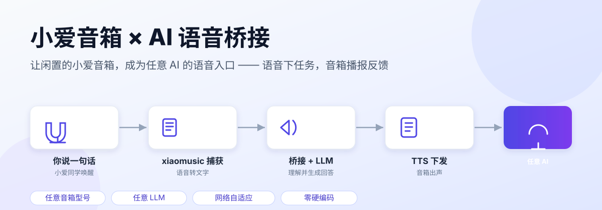

# Xiaomi Speaker WorkBuddy Bridge
[](LICENSE)
[](https://www.python.org/)
[](CONTRIBUTING.md)

[中文](README.md) | **English**

Turn any Xiaomi / XiaoAI speaker into a voice front-end for any AI (WorkBuddy / DSH / Claude / Codex / Qwen / any agent) — give voice commands, get spoken answers.



## Why

- **Revive an idle speaker**: turn a dusty XiaoAI speaker into an AI voice assistant that answers anything.
- **Any model, any speaker**: the speaker is controlled through xiaomusic + Mi cloud; the brain is any OpenAI-compatible LLM.
- **Self-healing network**: IP changes need no code edits — addresses, gateway and docker channel are auto-discovered.
- **Privacy first**: keys can live in environment variables; a single config source for password / port.

## How it works


**Key point**: the AI only handles text — how the speaker makes sound is unrelated. Swap in any LLM.

## Requirements

| Need | Notes |
|------|-------|
| Docker | xiaomusic container running |
| Mi account | Logged into xiaomusic Web UI, speaker shows online |
| Python 3.10+ | `pip install aiohttp` |
| Any OpenAI-compatible LLM | Zhipu GLM / DeepSeek / Ollama local all work |
| Network (optional proxy) | Only needed to fetch dependencies; if blocked, set your own: `export https_proxy=http://<host>:<port>` |

## Quick start (5 steps)

```bash
cp assets/config.example.json scripts/config.json
# edit scripts/config.json: llm.api / llm.model / llm.key (or env XIAOPI_LLM_KEY)
```

1. **Probe network** (recommended): `python3 scripts/netprobe.py` — prints detected addresses. No manual IP needed.
2. **Deploy plugin**: `python3 scripts/deploy.py --dry-run` then `python3 scripts/deploy.py`. If docker auto-detect fails: `--docker-cmd "ssh root@<gateway-ip> docker"`.
3. **Start bridge**: `cd scripts && python3 bridge.py`; verify with `curl http://127.0.0.1:<port>/health`.
4. **Test live**: say "XiaoAi... <your keyword>, are you there" — confirm the speaker actually talks (check `do_tts ok` in xiaomusic logs, not just the API OK response).

## Configuration

All knobs live in `config.json`; `deploy.py` syncs the keyword / port / assistant name to xiaomusic in one pass. CLI flags and `XIAOPI_*` env vars can override temporarily (priority: CLI > env > config > built-in defaults).

See [references/setup.md](references/setup.md) for the full field table and model adapter notes.

## Voice commands

| Say | Effect |
|-----|--------|
| `<keyword>, note task: xxx` | append to `tasks.md` |
| `<keyword>, list tasks` | read task overview aloud |
| anything else | LLM Q&A, spoken back |

## Dialect support

Fill `assets/dialect.md` (see [references/dialect.md](references/dialect.md)) to help the LLM understand dialect words. Note: this improves *understanding*, not the microphone — pure dialect won't pass Mi cloud ASR.

## Scripts

| Script | Purpose |
|--------|---------|
| `bridge.py` | core service (LLM + TTS + tasks + history) |
| `deploy.py` | one-shot deploy (probe → patch → restart → verify) |
| `netprobe.py` | network auto-discovery |
| `patch_xiaomusic.py` | in-container idempotent patch with backup |
| `restore_token.py` | rebuild token from auth.json backup |
| `healthcheck.py` | local self-check (no network, no privacy leaks) |

## Troubleshooting

See [references/pitfalls.md](references/pitfalls.md) (bug ①–⑩) and the in-repo issue templates.

## Contributing

Issues and PRs welcome — see [CONTRIBUTING.md](CONTRIBUTING.md). Run `python3 scripts/healthcheck.py` before submitting. Changelog: [CHANGELOG.md](CHANGELOG.md).

## Related projects

- [xiaomi-speaker-workbuddy-bridge](https://github.com/zhanglmyf/xiaomi-speaker-workbuddy-bridge) **(this project)** — Turn any Xiaomi speaker into a voice AI assistant
- [dsh-universal-installer](https://github.com/zhanglmyf/dsh-universal-installer) — Deploy DeepSeek Harness anywhere
- [dsh-free-model-bridge](https://github.com/zhanglmyf/dsh-free-model-bridge) — Auto-load free cloud models into DSH
- [lan-transparent-proxy](https://github.com/zhanglmyf/lan-transparent-proxy) — One-click LAN transparent proxy

## License

MIT — free to use, modify and distribute.
