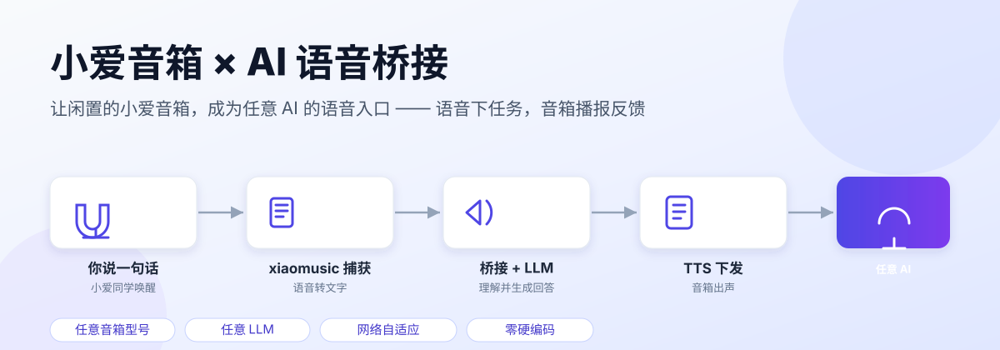

# Xiaomi Speaker WorkBuddy Bridge

[](https://opensource.org/licenses/MIT)
[](https://www.python.org/)
[](CONTRIBUTING.md)
[](https://github.com/zhanglmyf/xiaomi-speaker-workbuddy-bridge/stargazers)

**中文** | [English](README.en.md)

把任意型号小米/小爱音箱接入 AI（WorkBuddy / DSH / Claude / Codex / 通义千问 / 任何 Agent），实现**语音下任务、音箱播报反馈**。



> ⭐ 如果这个项目对你有帮助，点个 **Star** 就是最大的支持，也帮助更多人发现它。

## 为什么用它

- **盘活闲置音箱**：家里吃灰的小爱音箱，变身能回答任何问题的 AI 语音助手
- **任意型号 / 任意 AI**：音箱走 xiaomusic 云端控制，模型只要 OpenAI 兼容接口，都可替换
- **网络自适应**：IP 变了不用改代码，地址、网关、docker 通道全部自动发现
- **隐私可控**：密钥可只放环境变量；所有配置单一来源，随时改口令/端口

## 链路原理


**关键点**：AI 模型只处理文字，和"音箱怎么响"无关。换任何 LLM 都能跑。

## 前置条件

| 必须 | 说明 |
|------|------|
| Docker 环境 | xiaomusic 容器已跑起来 |
| 小米账号登录 | xiaomusic Web UI 能看到音箱设备在线 |
| Python 3.10+ | 安装 `aiohttp`：`pip install aiohttp` |
| 任意 OpenAI 兼容 LLM | 智谱 GLM / DeepSeek / Ollama 本地均可 |
| 网络（可选代理） | 仅当环境需要联网拉依赖时用到；如直连不通，按**你自己的环境**设置，例如 `export https_proxy=http://<代理主机>:<端口>`（地址因人而异，请替换成你的代理） |

## 快速开始（5 步）

### 1. 复制配置

```bash
cp assets/config.example.json scripts/config.json
```

编辑 `scripts/config.json`，必填项：

```json
{
  "llm": {
    "api": "https://open.bigmodel.cn/api/paas/v4/chat/completions",
    "model": "glm-4-flash",
    "key": "YOUR_API_KEY_HERE"
  },
  "xiaomusic_url": "auto",        // auto=自动发现；或填 http://NAS:58090
  "port": 8900,                   // 桥接服务监听端口
  "wake_keyword": "小皮小皮"      // 语音口令（可在网页/APP改）
}
```

其他常用字段：

| 字段 | 作用 | 示例 |
|------|------|------|
| `did` | 音箱 miotDID；留空自动发现 | `""` |
| `device_match` | 多设备时按型号筛选 | `"LX06"` |
| `assistant_name` | 助手名 | `"小皮"` |
| `owner_name` | 主人称呼（填你自己的，仅进系统提示） | `"主人"` |
| `workspace_dir` | 任务单/存档落点 | 留空用 `scripts/data/` |
| `dialect_file` | 方言表 | `"dialect.md"`（可选） |

密钥也可只放环境变量避免写入文件：
```bash
export XIAOPI_LLM_KEY="YOUR_KEY"
```

### 2. 网络探测（推荐先跑）

```bash
python3 scripts/netprobe.py
```

输出报告包含：自身 IP、网关、docker 通道、xiaomusic 地址、桥接地址候选。**不用手填 IP**。

### 3. 部署到 xiaomusic 容器

```bash
# 无损预演（不修改任何东西）
python3 scripts/deploy.py --dry-run

# 正式部署（会自动打补丁、重启容器）
python3 scripts/deploy.py
```

如果自动探测不到 docker，手动指定通道：
```bash
python3 scripts/deploy.py --docker-cmd "ssh root@<你的NAS或网关IP> docker"
```

deploy 做的事（全部幂等、改前自动备份）：
1. 写插件 `/app/plugins/<plugin>.py`（POST 桥接服务）
2. `setting.json` 注册口令 + active_cmd
3. `conversation.py` 注入 cookies 补丁（修 400 错误）
4. `miaccount.py` 注入 token 保留补丁（根治登录失败删凭证的顽疾）

### 4. 启动桥接服务

```bash
cd scripts
python3 bridge.py
```

验证：
```bash
curl http://127.0.0.1:8900/health
# 返回 {"ret":"OK","model":"glm-4-flash","did":"...",...}
```

**不要在 WorkBuddy 容器里用 nohup setsid 启动**——会继承受限环境导致 errno 38。用受管后台方式或直接前台运行后 Ctrl+C 退出。

### 5. 真人验证

喊：**「小爱同学……（停顿），<口令>，在吗」**

确认音箱出声（不要只看接口返回 OK，要看 xiaomusic 日志里的 `do_tts ok`）。

## 语音指令

| 你说 | 效果 |
|------|------|
| `<口令>，记任务：xxx` | 写进 `tasks.md` |
| `<口令>，查看任务` | 念一遍任务概览 |
| 其他问题 | 走 LLM 问答并播报 |

## 方言支持

填充 `assets/dialect.md`（参考 `references/dialect.md`）让 AI 理解方言词汇：

```markdown
## 词汇对照
- 今朝 = 今天
- 落雨 = 下雨
- 伐 = 吗（疑问词）
```

内容自动注入系统提示。注意：**只能提升"懂"，不能解决"听"**——纯方言过不了小米 ASR。

## 脚本清单

| 脚本 | 用途 |
|------|------|
| `bridge.py` | 核心桥接服务（LLM + TTS + 任务单 + 存档） |
| `deploy.py` | 一键部署编排（探测通道 → 打补丁 → 重启 → 验证） |
| `netprobe.py` | 网络自动发现（IP/网关/容器/xiaomusic 地址） |
| `patch_xiaomusic.py` | 容器内补丁（插件/口令/cookies/token 保留） |
| `restore_token.py` | 凭证丢失时从 auth.json 备份重建 `.mi.token` |
| `healthcheck.py` | 本地自检（无网络，验证完整性 + 脱敏） |

## 排障速查

| 症状 | 先看 | 详细 |
|------|------|------|
| 喊了没反应 | token 在不在、对话捕获是否 400 | [references/pitfalls.md](references/pitfalls.md) 坑①② |
| 接口 OK 但没声 | 容器日志 `do_tts ok` / `Login failed` | 坑③ |
| health 无响应 / errno 38 | 进程卡死，按 PID 重启 | 坑④ |
| 启动脚本把自己杀了 | pkill/grep 自匹配 | 坑⑤ |
| 方言听不懂 | 小米 ASR 不支持吴语 | [references/dialect.md](references/dialect.md) |

## 网络自适应

**音箱 IP 从不参与链路**——靠 miotDID + 小米云端受控。真正变的三个量由 `netprobe.py` 自动发现：
- xiaomusic 地址（本机 → 网关 → docker inspect → 网段并发探测）
- 桥接可达地址（容器内访问 WorkBuddy 的地址）
- docker 通道（本地 docker / ssh 网关 / ssh NAS）

网络变化后：`curl 'http://127.0.0.1:<port>/health?reset=1'` 强制重探自愈。

## 安全与脱敏

- **不打包**任何真实 API Key / DID / 账号凭证
- 密钥通过环境变量 `XIAOPI_LLM_KEY` 传入，或写入 config.json（自行保管）
- 配置文件建议加入 `.gitignore`

## 通用性说明

本方案由两层组成：

| 层 | 组件 | 通用性 |
|----|------|--------|
| 执行层 | `scripts/*.py`、`assets/*.json`、`references/*.md` | ✅ 任何环境可用（Python 3.10+ + aiohttp）|
| 驱动层 | `SKILL.md`（frontmatter） | ❌ WorkBuddy 专用，其他 Agent 需自己写触发规则 |

其他 Agent（DSH/Claude/Codex/通义千问等）拿到 `scripts/` 目录即可手动调用，语音入口不依赖具体 AI 模型。

## 参与贡献

遇到问题或有想法？欢迎提 [Issue](https://github.com/zhanglmyf/xiaomi-speaker-workbuddy-bridge/issues) 或 [贡献代码](CONTRIBUTING.md)。提交前可先跑本地自检：

```bash
python3 scripts/healthcheck.py
```

改动记录见 [CHANGELOG.md](CHANGELOG.md)。

## License

MIT —— 自由使用、修改、分发。
